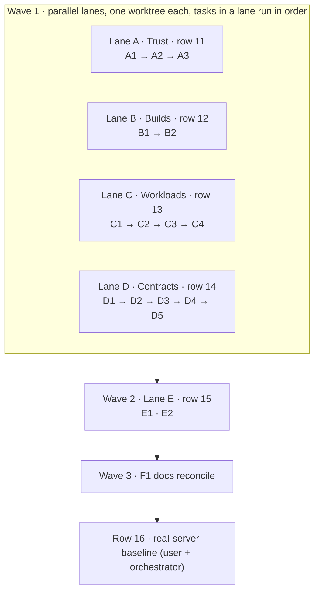

# ALPHA-SPEC — worker tasks for MASTER rows 11–15

> **Temporary.** This file is deleted when `v1.0.0-alpha.1` is tagged. MASTER §9
> owns status and order; this file only says *how* each row is built and
> reviewed. The direction was approved in the alpha.1 one-pager (2026-10-28);
> decisions are MASTER D7, D12, D17, D21, D29–D31. Code anchors are from
> snapshot `a7478c4` and drift as lanes merge. Re-locate them by symbol,
> not line number.

## 0. How this runs



**Merge order inside Wave 1:** A before D (`internal/cli/noderpc.go`,
`context.go`), and B before C (`internal/controlplane/platform_deploy.go`). The
orchestrator rebases the later lane and re-runs its checks. **Lane C alone adds
migrations, numbered 014, 015 and 016 in task order.** No other lane creates a
migration file.

### Loop for every task

1. The **worker** gets one task section plus §1 and works in its lane's
   worktree. It commits on the lane branch (never `master`), never pushes, and
   ends with the **report** in §1.4.
2. The **reviewer** gets the task section, §1, §2 and the diff, in a fresh
   context. It returns **pass** or numbered findings, each with a file:line and
   the rule it breaks. A finding must be a defect against the task, MASTER or
   AGENTS.md, not a style preference.
3. There are at most **two rework rounds**. After that the orchestrator either
   decides or escalates to the user.
4. The orchestrator integrates into the `master` working tree **uncommitted**,
   re-runs §1.3, and the user commits.

## 1. Rules for every worker

### 1.1 Read first

`AGENTS.md`, `docs/MASTER.md` (D-numbers named in your task), the
`docs/IMPLEMENTATION.md` sections your task touches, and the deploycrate or
vaire file your task cites. Read the code around every anchor before changing
it.

### 1.2 Never

- Put a plaintext secret, TOTP code, token or DSN into operation input, River
  args, events, journals, logs, errors or ordinary output. Codes travel only in
  `rpc.Request.Secrets` (`protect.CodeSecret`) and are registered with the
  redaction registry.
- Add compatibility aliases, shims, fallback flags or "legacy" paths (pre-v1:
  delete the old path).
- Edit an applied migration (001–013). New migrations are Lane C only.
- Add Docker, Incus, VM or SSH-fixture test harnesses. Do not run tests that
  start Docker. PostgreSQL integration tests run only against an explicit
  `EREGION_TEST_DATABASE_URL`; without one, write the test and report it
  **not run**.
- Touch a server, a DNS zone, a release, or any ambient DSN or context.
- Add a prompt with no flag equivalent, or let `--json` or no-TTY prompt.
  Factor-gated actions are the exception: they *refuse* without a terminal.
- Widen scope. If you find an unrelated defect, list it in your report under
  "Found, not fixed".

### 1.3 Checks before reporting

```sh
just fmt-check
go build ./...
go vet ./...
GOOS=darwin GOARCH=arm64 go build ./...
go test ./internal/<each changed package>/...   # inspect first: skip tests that start Docker
bin/eregion commands --json >/dev/null           # after `just build`, when the CLI surface changed
```

### 1.4 Report format

```text
Task: <ID>   Branch: <name>   Commits: <short SHAs>
Changed: <files, one line each, what and why>
Tests added: <test names → what they prove>
Checks: fmt / build / vet / darwin / tests (<packages>) — pass|fail with output
Not run: <tests and why>
Docs updated: <file §>
Acceptance: <each bullet from the task → how it is shown>
Found, not fixed: <unrelated defects>
```

## 2. Reviewer checklist (applies to every task)

- [ ] Every acceptance bullet is demonstrated by a test or a stated manual step.
- [ ] Each new regression test fails on the old code: the reviewer checks this by reasoning, or by running it against the pre-change code.
- [ ] No secret, code, token or DSN reaches input, events, logs, errors or plain/JSON output. Grep the diff for every new `Secrets`, `fmt.Errorf` and event append.
- [ ] No shim, alias, dead path or "kept for compatibility" code. Removed paths are fully deleted, including tests and docs.
- [ ] JSON and no-TTY never prompt; every new prompt has a flag; new flags appear in `CommandMeta` and `commands --json`.
- [ ] Faults use `contract.NewFault` with an existing code and an actionable fix line, matching nearby code.
- [ ] Applied migrations are untouched; new migrations are additive and numbered as in §0.
- [ ] Tests that start Docker or need a database were not run silently: they're reported as not run.
- [ ] Changed behavior is reflected in IMPLEMENTATION.md (the current-code description). MASTER changes go through the orchestrator only.
- [ ] The diff stays in the task's files-in-scope, or each extra file is justified.

---

## Lane A — Trust boundary (MASTER row 11; D7, D12)

### A1 · The factor is verified in the same request

**Gap.** `vault.export` never checks the code
(`internal/cli/noderpc.go` → `dispatchNodeMethod` case `methodSecretExport`).
The CLI checks it in a separate `protect.verify` call (`secret.go` →
`exportSecret`), so a direct RPC skips the factor. App and env delete have no
factor at all (`internal/cli/delete.go` → `runDelete`). `handoff.export` and
`token.create` already verify in-request (`dispatchLocalMethod`): keep them
as they are.

**Design.**
- Node: one helper, e.g. `requireFactor(request rpc.Request) error`, calls
  `protect.NewStore().Verify(request.Secrets[protect.CodeSecret])`. It's called
  - for `vault.export` **before** `openNodeApp`;
  - for `operations.submit` when `params.Kind` is `platform.app.delete` or
    `platform.environment.delete` and `!request.DryRun`, after
    `ValidateConfirmation`.

  An unconfigured protect store returns the existing "run eregion protect init"
  precondition fault.
- CLI: `secret export` sends the code with `ExportSecret` (add a code
  parameter) and stops calling `ProtectVerify`. When `protect.verify` /
  `ProtectVerify` have no callers left, **delete** the method, its constant,
  its interface entry and its dispatch case.
- CLI: `runDelete` without `--dry-run` calls `requireHuman(cmd, "eregion app
  delete")`, or the env equivalent, then `readProtectCode`, and passes the
  code via `rpcCallOptions.Secrets`. `SubmitAction` needs a secrets
  parameter, or a sibling that takes one. Dry-run stays factor-free and agent-usable.
- Delete `CommandMeta` declares that it prompts and is human-only, in the same
  way the export commands declare it (mirror `secretMeta` / export meta).
- HTTP: `/v1/operations` must refuse delete kinds whatever the grant, because
  there's no factor channel. Add an explicit refusal and a test, even if grants
  already block it today.
- `internal/guide` (agent guide): agents can dry-run deletes but can't
  perform them; deletion, export and token creation are human-only. Also state
  that application-database backup is operator-owned (D4/D19), and that
  sensitive values belong in `secret set`, not `config set`.

**Files in scope.** `internal/cli/noderpc.go`, `secret.go`, `delete.go`,
`meta.go` (if needed), `internal/api` (operation submit refusal), `internal/guide`,
their tests.

**Acceptance.**
- A `vault.export` request with no code, or a wrong code, fails on the node with the factor fault, and no value is returned.
- An `operations.submit` of `platform.app.delete` or `platform.environment.delete` without a valid code fails; the same request with `dry_run` succeeds.
- `eregion app delete x --confirm x --json` refuses with `input_required` before any RPC.
- One code is consumed once per export: no double verify.
- An HTTP submission of a delete kind is refused.

**Tests.** Unit tests on the dispatch path with a temp-path `protect.Store`
(use the store's `Path` field), plus CLI tests for refusal under
`--json` / `--yes` / pipe.

### A2 · Dry run never installs a node binary

**Gap.** `nodeClient.ensureVersion` (`noderpc.go`) installs and restarts on a
mismatch whenever `autoUpgrade` is set, even under `--dry-run`.

**Design.** The node client knows whether the invocation is a dry run: set it
in `nodeClientFor` from the command's `dry-run` flag when present. On a
mismatch under dry-run, return `node_version_mismatch` with detail
`"would upgrade node from X to Y; run without --dry-run"`. Never install.
Apply this to **every** command, not just `apply`.

**Acceptance.** `--dry-run --auto-upgrade-nodes` on a mismatched node returns
the mismatch fault, and `upgrade.install` is never called. Without
`--dry-run`, behavior is unchanged.

**Tests.** A table test over `ensureVersion` with a fake remote that records
calls.

### A3 · A release-build node installs only verified release binaries

**Gap.** `upgrade.install` (`installNodeBinary`) accepts any file under
`/tmp/eregion-*` whose sha256 the *caller* supplies, which is root without the
factor.

**Design.**
- `rpcInstallParams` gains `Version` and `Channel`.
- When the **node's** `buildinfo.Channel` is not `dev`, the node resolves the
  signed manifest itself (`release.Client.Resolve(channel, version)`,
  cosign-verified), and refuses unless the uploaded file's sha256 equals
  `manifest.Artifacts["linux/"+runtime.GOARCH].SHA256`. Channel and version
  must be valid for the release identity rules in `internal/release`.
- A `dev` node keeps today's checksum-only path. That's the documented
  developer escape, and it never applies to a published node.
- CLI: `installUploadedBuild` sends its own `buildinfo.Version/Channel`. A
  dev CLI against a release node is refused, with a fix line telling the
  operator to use a released CLI.
- Network failure resolving the manifest returns `unavailable`. The node never
  falls back to trusting the upload.

**Acceptance.** A release node refuses an upload whose hash isn't in the signed
manifest, and accepts the matching artifact. A dev node is unchanged.

**Tests.** Inject the release client and verifier behind a small interface
(follow the existing `Verifier` seam in `internal/release`). No network in
tests.

**Docs (Lane A).** IMPLEMENTATION "Current command surface" (deletes,
exports, `upgrade`), "Release and local upgrade"; `docs/security-review.md`
gets the D7 boundary statement.

---

## Lane B — Deterministic builds (MASTER row 12; D11, §6.3)

### B1 · Git builds honour `context_path`

**Gap.** `createReleaseFromRevisionTx` records `Path: source.ContextPath` on
the build source, but `platform_deploy.go` (pack payload, `case "git"`) drops it,
and `PackStep.Apply` (`internal/platform/step.go`) runs `pack --path <clone root>`.

**Design.** `PackPayload` gets `GitContextPath`, which is valid only alongside
`GitURL`; extend payload validation next to the existing `Path` / `GitURL`
check. After checkout, resolve `filepath.Join(src, ctx)` with
`filepath.EvalSymlinks`. Refuse permanently if the result escapes the clone
(including via symlinks) or isn't a directory, with a message naming the
configured path. `--path` then gets the resolved directory.
`validateContextPath` (`actions.go`) stays the input gate.

**Acceptance.** A repo with `apps/web/go.mod` and `context_path=apps/web`
builds from that directory. `../x` is refused at input, and a symlink that
escapes is refused at build.

**Tests.** Pure tests on payload validation and context resolution using a temp
dir tree with a symlink. Pack itself is not run.

### B2 · The ref resolves to an exact commit at submission

**Gap.** `createReleaseFromRevisionTx` leaves `commit = ""`. The commit is
written only on success (`platform_deploy.go`: `SET state='succeeded',commit_sha=…`),
and `createRetryReleaseTx` falls back to `Source.Ref`. So retrying a failed
branch build builds whatever the branch points at now. MASTER 6.3 and
deploycrate (`build.SourceRevision` at creation) both resolve at submission.

**Design.**
- New `platform.ResolveGitRef(ctx, url, ref string, credential []byte) (sha
  string, err error)`, using `git ls-remote` with the same askpass helper and
  isolation as the build. The credential goes in through the child environment
  only, never argv. Disable redirects and other protocols as `PackStep` does,
  re-check the host allowlist, and use a 30 s timeout.
  - A 40-hex ref is returned unchanged; an abbreviated SHA is refused with a fix.
  - Otherwise match `refs/heads/<ref>` and `refs/tags/<ref>`, preferring the
    peeled `^{}` for annotated tags. Both matching is `validation_failed`
    (ambiguous); neither is `precondition_failed` with the ref named.
- Call it **before** the submission transaction opens, for every path that
  creates a git release from a revision: `platform.deploy` without
  `release_id`, CI deploy, app/env create with deploy, and the `ref` override.
  Resolve the credential by name from the vault in the service, as the build
  does. Pass `(url, ref, sha)` into the transaction. If the revision's
  url/ref changed in between, fail with `conflict` ("environment source
  changed during submission; retry").
- Store the SHA on the build **and** the release rows at insert. The webhook
  already carries the pushed SHA, so it needs no resolution.
- `PackStep` checks out exactly that SHA (the `shaPattern` path) and refuses
  if `rev-parse HEAD` differs.
- `createRetryReleaseTx` uses only `old.CommitSHA`. If it's empty, it refuses
  with the existing "no exact commit" fault; it never uses a branch name.
- A remote that can't be reached at submission returns `unavailable`, and
  no operation is created.

**Acceptance.** After the branch moves, `build retry` of a failed build
rebuilds the original commit. `deploy --ref main` records the SHA on the
build before the build starts. A private repo resolves with its credential,
and the credential value appears in no argv, event or error.

**Tests.** Unit tests for ref matching over captured `ls-remote` output
(heads, tags, peeled, ambiguous, missing). Retry-source tests that build no
release rows. If the transaction path needs a DB test, write it and report it
not run.

**Docs (Lane B).** IMPLEMENTATION "Current application actions" (deploy
sequence, build retry); MASTER 6.3 already matches.

---

## Lane C — Workloads and probes (MASTER row 13; D17, D21, D29, D31)

### C1 · The release command is release-scoped (migration 014)

**Gap.** `platform_deploy.go` runs `runtime.release_command` on every
deployment, including restart, scale and rollback. deploycrate
(`services/release_deployment.go`, `ReleaseCommandExecution.ForRelease`) runs
it once per release.

**Design.**
- Migration `014_release_command_runs.sql`: a table
  `eregion_platform_release_command_runs`
  - columns: `release_id`, `command_digest`, `operation_id`, `state`
    (`running|succeeded|failed`), `error_code`, `error`, `started_at`,
    `completed_at`;
  - unique on `(release_id, command_digest)`.

  The digest is the sha256 of the canonical command spec: argv plus timeout.
- Deploy path (`platform.deploy`, new or `--release`):
  - **succeeded** → skip, and emit the event "release command already
    succeeded for this release".
  - **failed, or no row** → run it, then upsert the result.
  - **running** under another live operation → `conflict`.
- Restart, `process scale` (which queues a restart) and rollback **never
  run** the command. If the target release's command for the revision they
  apply hasn't succeeded, they refuse with `precondition_failed` and the fix
  "deploy the release first".
- The run happens once per release, before candidate containers start, and
  stays release-scoped: don't key it by deployment or node.
- Delete cascade: rows go when their release rows go, under D13.

**Acceptance.**
- Deploy runs the command once.
- Scale, restart and rollback to that release emit the skip event and run no
  container for it.
- A failed command fails the deploy, leaves the old release serving, and a
  re-deploy runs the command again.
- A changed release command (new digest) runs again on the next deploy.

**Tests.** Pure decision function `releaseCommandAction(row, kind) →
run|skip|refuse` with a table test. The SQL path in a DB test, not run without
`EREGION_TEST_DATABASE_URL`.

### C2 · Per-domain check path and public-step evidence (migration 015)

**Gap.**
- `observeDomains` (`domain_observe.go`) probes every domain at the
  environment health path, so the andurel admin alias stays `failed` forever.
- `verifyPublicRoute` (`routes.go`) logs no host, path or status.
- The observer has `LIMIT 50`, so domains past the 50th are never observed.

**Design.**
- Migration `015_domain_check_path.sql`: `eregion_platform_domains.check_path
  text NOT NULL DEFAULT ''`, where empty means the web health path.
- `DomainInput.CheckPath`: validated as an absolute path with no scheme or
  host, ≤ 256 characters and no control characters. Reuse the health-path
  validator if there is one.
- `domain add … --check-path PATH`. Re-adding an existing binding updates
  it; this is already an idempotent upsert in `insertDomainTx`. Shown in
  `domain list` and the `domains` inventory.
- The observer uses `coalesce(NULLIF(d.check_path,''), <health path>)` and
  walks **all** domains in bounded pages (keyset by name), not just the first 50.
- `verifyPublicRoute` uses the primary's check path and appends a worker event
  `public check https://<host><path> → <status>` on success and on each
  failure. Gating stays primary-only: aliases are reported by the observer,
  not gated.

**Acceptance.** An alias with `--check-path /users/sign-in` reaches
`public=ok` while `/api/health` 404s on it. The deploy events name the host,
path and status. A 60-domain fixture is fully observed.

**Tests.** Input validation; observer query paging (pure helper, or a DB test
not run); event text.

### C3 · Container cleanup is recorded and retried (migration 016)

**Gap.** `removeDeploymentContainers` (`platform_deploy.go`) runs `docker rm
-f` with `AllowFailure: true`. Failures disappear; `removePreviousDeploymentContainers`
and `reconcileDeploymentCleanup` only append events. App and env delete
(`platform/delete_step.go`) are correct: don't touch them.

**Design.**
- Migration `016_container_cleanup.sql`: a table
  `eregion_platform_container_cleanup`
  - columns: `container_name` (primary key), `environment_id`, `node`,
    `deployment_id`, `reason`, `attempts`, `last_error`, `created_at`,
    `next_attempt_at`;
  - cascade on environment delete.
- Removal is no longer `AllowFailure`. A missing container counts as success
  (`No such container`). Any other failure upserts a cleanup row, and the
  verified switch's result is unchanged (D17).
- A periodic maintenance job (in `jobs.go`, next to the domain jobs, every
  5 min, `RunOnStart`) retries due rows with backoff and deletes a row on
  success.
- `env status` / `app status` show "N leaked containers pending cleanup", with
  names in JSON.

**Acceptance.** A forced `docker rm` failure leaves the deploy succeeded, a
row present and a status line. The next job run removes the container and the
row.

**Tests.** Classification of `docker rm` output (missing vs failure); backoff
schedule; status rendering.

### C4 · Serving-container repair at worker start (D31)

**Gap.** Nothing restores a serving container that disappeared (reboot, OOM,
manual `rm`). deploycrate does: `services/workload_reconciliation.go`,
`queueMissingServingRecovery`.

**Design.**
- On worker start (a `RunOnStart` maintenance job, plus every 5 min), for each
  environment with a serving deployment on a reachable node:
  - compare the recorded `instances` names with `docker ps --all` by
    ownership labels;
  - a missing instance, or one that exited and wasn't restarted by `unless-stopped`,
    queues **one** `platform.restart` of the serving release;
  - idempotency key `repair:<deployment_id>:<sorted missing names hash>`;
  - actor: the system actor already used by maintenance.
- Skip an environment with an active deploy, restart or delete operation.
- Restart doesn't run the release command (C1).

**Acceptance.** Removing a serving web container, then restarting the worker,
produces one restart operation and the container is back. A second worker
start with nothing missing queues nothing. Two concurrent workers queue one
operation, thanks to the idempotency key.

**Tests.** A pure diff of recorded vs observed instances; key stability; skip
rules.

**Docs (Lane C).** IMPLEMENTATION: database schema (014–016), the deploy
sequence, domains, maintenance jobs, status; `docs/network.md` (check path);
MANUAL-TESTING gets new checks: alias check path, release command skip on
scale and rollback, and container repair after a worker restart.

---

## Lane D — Operator contracts (MASTER row 14)

### D1 · `login` is atomic, and replacing needs `--replace`

**Gap.** `login.go` removes and rewrites `ssh_ed25519`, `wireguard.key` and
`sudo-password` for the bundle's context name **before** the host-key probe and
`ready`. A bad bundle destroys a working context.

**Design.**
- Write the identity into a sibling temp dir (`0700`) and build the route
  against it.
- Probe and pin the host key against a temp copy of known_hosts, then run
  `ready`.
- Only then swap atomically: rename the old dir to a backup, the new dir into
  place, remove the backup. Save the context and merge the pinned key.
- If the name exists, refuse with `conflict` unless `--replace <name>` names
  it exactly.
- Any failure removes the temp dir and leaves the old context untouched.

**Acceptance.** A login with a bundle whose node is unreachable leaves the
existing context working, byte for byte. Without `--replace`, an existing name
refuses before decryption side effects. `--replace other` is refused.

**Tests.** Use a fake probe and ready seam; files are compared before and after.

### D2 · A same-key create retry returns the original operation

**Gap.** On retrying `app create` / `env create` with the same
`--idempotency-key`:
- `previewAction` → `checkPreviewDomainAvailable`, or the "app already
  exists" check (`platform_state.go`), refuses;
- `writeSetupSecrets` / `putSecret` writes new vault revisions;

and both happen before `submitAccepted`, whose control-plane path would
correctly replay (the `ON CONFLICT … DO NOTHING` branch in the submit path).

**First:** reproduce it with a test and record the result in the report. If it
doesn't reproduce, stop and report.

**Design.** Preview learns replay. When `(actor, kind, target, idempotency_key)`
already exists, preview returns `replay: true` plus the existing operation, and
skips conflict checks. The CLI, on replay, skips every vault write and
calls submit, which returns the original op (input-hash checked). This applies
only when the operator supplied the key; generated keys are always new.

**Acceptance.** A retry with the same key and inputs returns the same operation
ID, writes no secret revision, and prints the same result shape. The same key
with different inputs gives the existing `conflict`.

### D3 · `--context` and `EREGION_CONTEXT`

**Gap.** Node commands always use the current context; `nodeClientFor(cmd,
"")`. Vaire has `-c/--context` and `VAIRE_CONTEXT` (`vaire internal/cli/root.go`,
`internal/contexts/contexts.go` → `Resolve`).

**Design.**
- A root persistent `--context NAME`. The order is flag, then
  `EREGION_CONTEXT`, then current.
- An unknown name is `not_found` with `eregion context list`.
- `context use` is unchanged.
- `server init` and `login` keep their own naming flags. If `--context` is
  given there, it must agree, or the command fails with a usage error.
- The resolved context name appears in JSON `meta`, if an envelope meta field
  exists; otherwise in no new place.

**Acceptance.** With current context `a`, `--context b app list` and
`EREGION_CONTEXT=b app list` reach `b`, and the flag wins over the variable.

### D4 · JSON shape fixes: `domain add`, `logs`

**Gaps.**
- `domain add --dry-run --json` returns `data` as a base64 string:
  `domain.go` assigns `json.Marshal` bytes (`[]byte`) to `preview.data`.
- `logs --json --follow` emits NDJSON (`logs.go`, the `streamJSON` condition),
  while `operations follow --json` returns one envelope.

**Design.**
- `preview.data = json.RawMessage(encoded)`. Grep the CLI for any other `[]byte`
  assigned to `result.data` and fix it the same way.
- `logs`: NDJSON only with `--output ndjson`. `--json --follow` is a usage
  error whose fix is `--output ndjson`. `--json` without `--follow` returns
  one envelope.

**Acceptance.** `jq .data.preview` works on `domain add --dry-run --json`, and a
table test over output modes for logs passes.

### D5 · `eregion ssh --command`

**Gap.** `ssh` is interactive only. Vaire's `ssh --command`
(`vaire internal/cli/ssh.go` → `runSSH`) runs one command, with no PTY
when piped or in JSON mode, and detects a sudo password prompt.

**Design.**
- Port vaire's behavior: `--command CMD` runs one command over the existing
  pinned SSH route and exits with the remote exit status.
- No PTY when stdin/stdout isn't a TTY or under `--json`.
- The sudo-prompt watch returns an `input_required` fault with vaire's fix
  text, adapted.
- Without `--command`, JSON/no-TTY refuses with a usage error, as now.

**Acceptance.** `eregion ssh --command 'uname -m' | cat` prints the remote
architecture and exits 0. A failing remote command's exit code propagates.

**Docs (Lane D).** IMPLEMENTATION command surface (`login --replace`,
`--context`, logs modes, `ssh --command`); `docs/contracts.md` (JSON/NDJSON
rule).

---

## Lane E — Guided finish (MASTER row 15; wave 2, after A–D merge)

### E1 · Guided create follows to serving or failed

**Gap.** `app create` / `env create` end at "accepted" (`app.go`, the
interactive card after `submitAccepted`). Vaire's long actions are watched
live, with Ctrl-C detaching and naming the follow command; eregion's `deploy`
already does this (`deploy.go` → `runDelivery` / `followAccepted`).

**Design.**
- The control plane exposes the first-deploy operation ID. It's created by
  `submitFollowupOperationTx` with key `first-deploy:<revision>`. Expose it
  in the create operation's result as `first_deploy_operation_id`.
- In a terminal, with deploy requested and no `--detach`, the CLI follows
  the create operation, then the first deploy, with the **same viewer and
  outcome card as `deploy`**.
  - Ctrl-C detaches and prints `eregion operations follow <id>`.
  - It ends with the serving URL, or the failed step and its error.
- `--detach`, `--json` and no-TTY return at "accepted", including
  `first_deploy_operation_id` in JSON.
- `--no-deploy` is unchanged.

**Acceptance.** Guided create on a healthy source ends at a card with the
public URL. A failing health check ends with the failed operation and its
error. JSON returns both operation IDs without waiting.

### E2 · `server init` ends with the doctor gate

**Gap.** Init ends at `ready` (`serverinit.go`, the "ready" task, then
node_exporter, DNS, certificate, handoff). MASTER 6.1 promises `doctor` as the
final gate. Vaire's version: `internal/node/doctor.go` → `doctorGate` (with
`init=true`) and `serverinit_db.go` (`skip_doctor`).

**Design.**
- After the certificate wait and **before** the handoff, run
  `client.HostDoctor`.
- Init mode leaves out checks that can't pass yet. The main-hostname
  certificate while DNS is pending stays a warning, as today.
- Any remaining `fail` stops init with a new fault code `doctor_failed`. It
  lists the checks and gives the fix "run each fix (eregion doctor shows
  them), then eregion server init --resume".
- The pending state records a new phase so `--resume` re-runs only the gate
  and the handoff.
- `--skip-doctor` skips the gate, with a warning in the result.
- The result card shows the doctor summary line.

**Acceptance.** Init on a healthy host ends with "doctor: N ok". A forced
failing check stops before the handoff, and `--resume` after the fix completes.

**Docs (Lane E).** IMPLEMENTATION "Bootstrap and local state", the
`app/env create` command rows; MANUAL-TESTING "Init apply" and "App create"
rows mention the gate and the follow.

---

## Wave 3 · F1 Docs reconcile (orchestrator, or one worker)

IMPLEMENTATION is re-checked against the merged code: header date, the schema
section through 016, and every changed command row. MASTER §8 rows are updated
by the orchestrator. `docs/security-review.md` gets the D7 boundary.
MANUAL-TESTING gets new rows for:
- factor-gated deletes;
- dry-run without auto-upgrade;
- a monorepo build;
- a retry of a moved branch;
- release command skips;
- the alias check path;
- leaked-container retry;
- serving repair;
- atomic login;
- `--context`;
- `ssh --command`;
- the init doctor gate;
- the guided create follow.

Delete `docs/ALPHA-PLAN.md` once its content lives here and in MASTER.

## Not in this spec

Row 17 (retention, D30) gets its own spec after alpha.1. So does anything in
MASTER "after v1". Field findings deferred by the one-pager: image
inspect/list, a durable image-push operation, `env status --sanitized`, and
app-database backup (operator-owned, stated in the agent guide by A1's guide edit).
